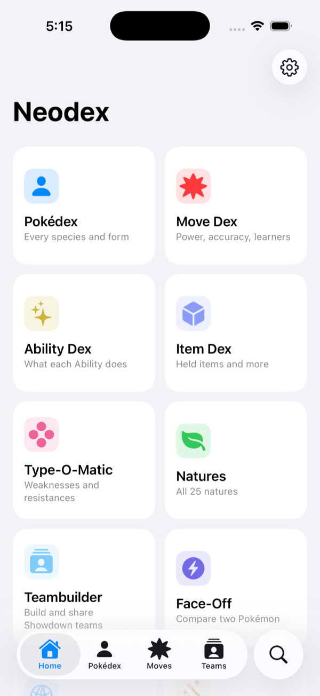
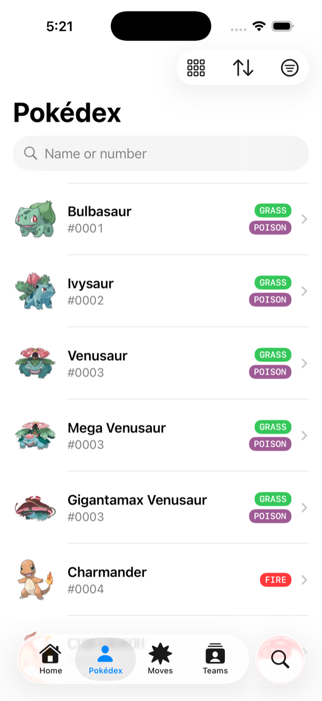
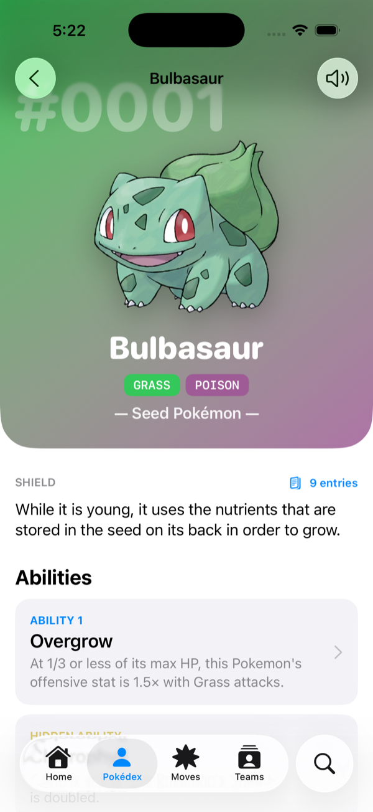
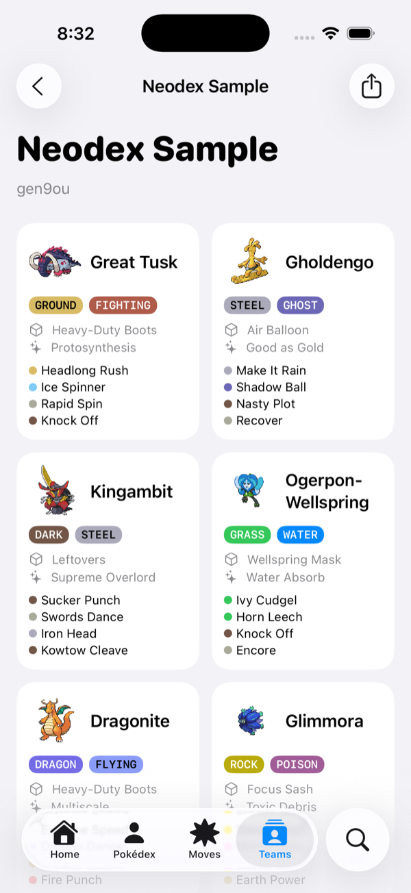
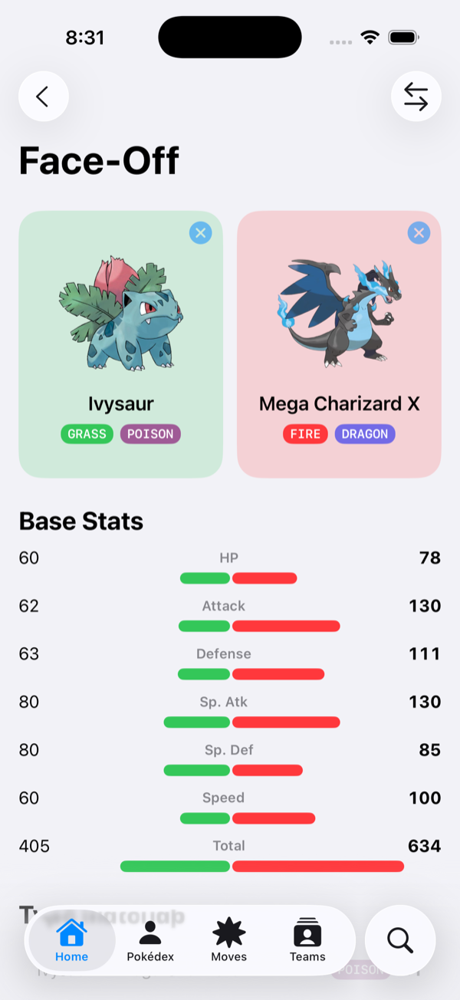
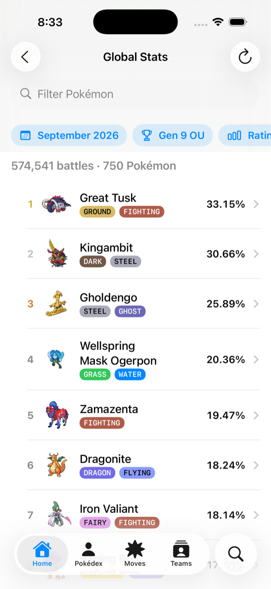

# Neodex

An offline Pokédex for iPhone, iPad, Mac and Apple Watch with [Pokémon Showdown](https://play.pokemonshowdown.com) teambuilding. Every species and form through the current generation, every move, Ability and item, type matchups, Smogon usage statistics, and teams you can paste straight into Showdown.

<p>
  
  
  
  
  
  
</p>

## Features

- **Pokédex** — 1,025 species and 1,330 forms (Megas, Gigantamax, regional variants, Paradox Pokémon, the Legends: Z‑A Megas), with filters, sorting, a grid mode, and a detail screen covering Pokédex entries from every game, abilities, base stats, evolutions, forms, traits, type matchups, locations and the full learnset. Showdown's animated battle sprites, shinies and cries stream in on demand, and every Pokédex entry from every game is a tap away.
- **Move, Ability and Item dexes** — in‑game descriptions alongside Showdown's competitive summaries, TM numbers, and reverse lookups (every Pokémon that learns a move or has an ability).
- **Type‑O‑Matic** — combine up to two types and see exactly what they're weak to and resist.
- **Teambuilder** — build teams of six with an editor that only offers legal moves, live stat calculation, EV/IV controls, natures and Tera Types. Import teams from Showdown's export text and export them back, byte‑for‑byte compatible. Teams are checked against the Smogon tier you pick, from Anything Goes to Little Cup, with every clause explained, and every team opens with its six sprites lined up like the original Neodex.
- **Damage Calculator** — Showdown‑faithful Gen 9 damage calcs in both directions between any two sets: EVs, natures, stat stages, items, abilities, Terastallization, weather, terrain, screens and status, with KO chances and the exact calc line to copy.
- **Face‑Off** — compare any two Pokémon side by side, then jump straight into a damage calc. On iPad and the Mac, drag one Pokémon onto another to face them off.
- **Global Stats** — Smogon usage rankings for any format and month, with abilities, items, moves, spreads, teammates and checks for every Pokémon, plus a usage‑trend chart across recent months. Star your favorite formats to reach them from a quick menu here and on Home.
- **Home** — jump back into what you were reading, picks based on your browsing (with one‑line reasons written on device by Apple Intelligence where available), a Pokémon of the day and what's popular on Showdown in the format you choose, above every feature.
- **Search** — one field for every Pokémon, move, Ability, item and nature, with colorful tiles to browse each dex and every type before you type.
- **Spotlight** — every Pokémon, move, Ability, item and nature is searchable from the Home Screen and deep‑links into the app.
- **Dexbot** — a Pokémon expert you can talk to. Powered by Apple Intelligence (on device, with Private Cloud Compute once Apple grants the entitlement), or by Claude with your own Anthropic API key, with tools that only read Neodex's own data and Smogon's statistics, so it answers about matchups, movesets, usage, damage and your own teams without inventing anything. Ask it for a team ("build me a rain team for OU") and it saves a full, legal one to your Teambuilder, picked and filled in from Smogon's statistics, with a card in the chat that opens it. Type on Home or in its tab, pick up any earlier conversation from the list, or hold a hands‑free voice conversation. "Hey Siri, ask Neodex…" works anywhere Siri does, including CarPlay; the app also includes a CarPlay voice‑based conversation scene (Apple granted the entitlement in October 2026).
- **Pokédex Scanner** — point the camera at a Pokémon, a trading card or a screen and the entry lights up, cry and all, like the show. An on‑device classifier trained in the pipeline on artwork, 3D renders, animated sprites and card illustrations (Apple's Vision scene‑print features with a softmax head) does the recognising, with printed names read as a second opinion; scan a photo or screenshot instead when there's no camera. The same recogniser plugs into iOS 26 visual intelligence, so Neodex's matches appear in the system camera's search.
- **Apple Watch** — a Pokédex on the wrist that works without the phone: Today (the same Pokémon of the Day and *Who's That Pokémon?* as the widgets), the type calculator, and every species searchable by name, number or dictation, with stats, abilities, matchups, evolutions and forms on each entry. Complications for the watch face and Smart Stack show the Pokémon of the Day, the daily silhouette (reveal it right from the stack) and a Poké Ball that opens the app. Over the link to the iPhone, your Teambuilder teams appear on the wrist as soon as you save them, and a Dexbot page takes a dictated question, wakes the iPhone, runs Apple Intelligence and answers in a sentence or two.
- **Mac** — a native Mac app from the same SwiftUI code: every feature in a sidebar, a Go menu with ⌘1–⌘9 for the sections, a Pokémon menu for the daily picks, and entries from Spotlight, Siri, Dexbot or that menu opening in their own windows so two Pokémon can sit side by side. Any Pokémon, move or sidebar section opens in a new window from its context menu, on iPad too. The Scanner uses the Mac's camera (or an iPhone over Continuity Camera), Dexbot runs on Apple Intelligence for Mac, and Settings lives under ⌘, where it belongs.
- **Scope Lens (Mac)** — a live observer and advisor for Pokémon Champions battles, merged in from its own project. It watches a mirrored game (an iPhone over QuickTime, or a capture card) through ScreenCaptureKit, reads the team preview and the battle with on‑device OCR and sprite matching, and advises with deterministic type and damage math from a TypeScript engine running in JavaScriptCore: scout reports, a live battle log, an opponent dossier, a floating overlay HUD, a battle archive with per‑turn review, and an opt‑in Claude‑powered “what's the play” advisor that uses your own API key. Scope Lens and the Pokédex know each other: any Pokémon, move, ability or item it shows opens its Neodex entry, a Neodex team becomes your Champions team in one click, and Dexbot can read the live board and suggest the play with no API key at all.
- **Widgets and Controls** — Pokémon of the Day (Home Screen and Lock Screen), a daily *Who's That Pokémon?* silhouette you reveal in place, one of your teams lined up like a battle preview, and Smogon's most‑used Pokémon in a format you choose. Control Center and Action button controls open a random Pokémon or the Damage Calculator.
- **Siri and Shortcuts** — ask what a Pokémon is weak to, have its Pokédex entry read aloud, open any Pokémon by name or get a random one; every species works in App Shortcuts phrases.
- Fully offline except for Smogon statistics and the optional animated sprites and cries, which are cached after first use. Every feature is a tab: a grouped, customisable sidebar on iPad and the Mac, and a customisable tab bar on iPhone. Dynamic Type and dark mode throughout.

## How it's built

Neodex is three pieces sharing one set of Swift types; see [Docs/ARCHITECTURE.md](Docs/ARCHITECTURE.md) for the full picture.

| Piece | What it is |
| --- | --- |
| [`Packages/NeodexKit`](Packages/NeodexKit) | Platform‑independent Swift package: models, an in‑memory Pokédex database, the type chart and stat formulas, a native parser/exporter for Showdown's team format, Smogon statistics parsers, a Showdown‑faithful damage calculator and Smogon format‑legality rules. Covered by Swift Testing suites. |
| [`Tools/NeodexData`](Tools/NeodexData) | A Swift command‑line tool that regenerates the bundled dataset from [Pokémon Showdown](https://github.com/smogon/pokemon-showdown) and [PokeAPI](https://github.com/PokeAPI/pokeapi), verifies every cross‑reference, and produces compact HEIC artwork. One command refreshes everything. |
| [`App`](App) | The SwiftUI app. iOS 27 and later, Swift 6 with strict concurrency, SwiftData for teams and history, a single typed route for navigation, Spotlight, Siri and `neodex://` deep links, App Intents, Swift Charts, Foundation Models with tool calling (and Anthropic's [Claude for Foundation Models](https://github.com/anthropics/ClaudeForFoundationModels) package for Claude), SpeechAnalyzer, CarPlay. |
| [`Mac`](Mac) | The native macOS app (`NeodexMac`): the `App` and `Shared` sources compiled for macOS 27 and later, plus this folder's Info.plist, App Sandbox entitlements and menu bar commands. The platform differences fit in one file of small shims, and images are decoded straight to `CGImage` so there is no UIKit/AppKit split. |
| [`Packages/ScopeLens`](Packages/ScopeLens) | Scope Lens as a Swift package only the Mac app links: window capture, OCR, the screen‑state machine, the battle reconciler, the JavaScriptCore engine bridge, the advisor and its windows, with the engine build and data as package resources. Kept in Swift 5 language mode, with its conventions in the package's `CLAUDE.md`; the spec, briefs and backlog are in [`Docs/ScopeLens`](Docs/ScopeLens) and the diagnostics harnesses and verification gate in [`Tools/ScopeLensDiagnostics`](Tools/ScopeLensDiagnostics). |
| [`Tools/ScopeLensEngine`](Tools/ScopeLensEngine) | The TypeScript engine (`@smogon/calc` plus usage priors) that becomes `engine.js`, its data bakers, the Pikalytics snapshot fetcher and the MCP server that exposes the same six tools. |
| [`Watch`](Watch) + [`WatchWidgets`](WatchWidgets) | The watchOS app, built from the same dataset and thumbnails (referenced, not copied) plus the `Shared` folder, and its complication extension. Five vertically paged screens: Today, Dexbot, Teams, Type‑O‑Matic and the searchable Pokédex, the middle two fed by WatchConnectivity. |
| [`Widgets`](Widgets) + [`Shared`](Shared) | The WidgetKit extension and the code it shares with the app (type palette, SwiftData models, the Smogon client). The app stocks an App Group with a compact Pokémon index, sprites and the daily pick schedule, so widgets never need the 49 MB bundle. |

The whole data bundle is about 49 MB, down from 454 MB of hand‑collected assets in the original app.

## Building

Requires Xcode 27 and an iOS 27+ simulator or device, or a Mac running macOS 27 or later (the watch app runs on watchOS 26 and later).

1. Open `Neodex.xcodeproj`.
2. Select the **Neodex** scheme and run. For the Mac app, select **NeodexMac** and run on My Mac.

The generated data and images are checked in, so the app builds without running the pipeline.

### Refreshing the data

```bash
cd Tools/NeodexData
swift run neodex-data                    # full refresh: data + images (about a minute)
swift run neodex-data --skip-images      # data only
swift run neodex-data --preview-fixture  # just the Xcode Previews fixture
swift run neodex-data --train-classifier # retrain the scanner's classifier (downloads card art; takes a while)
```

### TestFlight feedback

```bash
Tools/testflight feedback   # new TestFlight notes and screenshots, saved outside the repo
Tools/testflight builds     # recent uploads and whether they finished processing
```

It talks to the App Store Connect API with a key kept in `~/.appstoreconnect`; [Tools/TestFlightCLI](Tools/TestFlightCLI) covers the one-time setup.

### Tests

```bash
cd Packages/NeodexKit && swift test   # models, type chart, stat math, damage calc, legality, Showdown codec, Smogon parsers
cd Tools/NeodexData && swift test     # the data pipeline
cd Packages/ScopeLens && swift test   # Scope Lens: the engine, vocabulary and species index load from the package bundle
cd Tools/TestFlightCLI && swift test  # App Store Connect token signing, response decoding, the feedback archive
```

The Xcode scheme also runs the kit tests plus the app's bundled‑data smoke tests and feature tests for the intents, calculator and legality (⌘U). Every screen has an Xcode Preview backed by a small fixture cut from the real dataset.

## Data sources and licensing

- Competitive data (species, moves, abilities, items, learnsets, tiers, descriptions): [Pokémon Showdown](https://github.com/smogon/pokemon-showdown), MIT.
- In‑game descriptions, Pokédex entries, encounter data and official artwork: [PokeAPI](https://github.com/PokeAPI/pokeapi) and [PokeAPI/sprites](https://github.com/PokeAPI/sprites), BSD‑3‑Clause.
- Battle sprites and item icons: [Pokémon Showdown](https://play.pokemonshowdown.com/sprites/).
- Usage statistics: fetched live from [Smogon](https://www.smogon.com/stats/).

Neodex is a fan‑made reference. Pokémon and all related names and artwork are trademarks of Nintendo, Game Freak and The Pokémon Company; Neodex is not affiliated with or endorsed by them.

## History

Neodex started in late 2020 as one of my first SwiftUI projects, with data copied by hand from the web. In 2026 it was rebuilt from the ground up for iOS 26 with a reproducible data pipeline while keeping the original feature set and design language. The original code is preserved in this repository's history (`4152ff4`).
